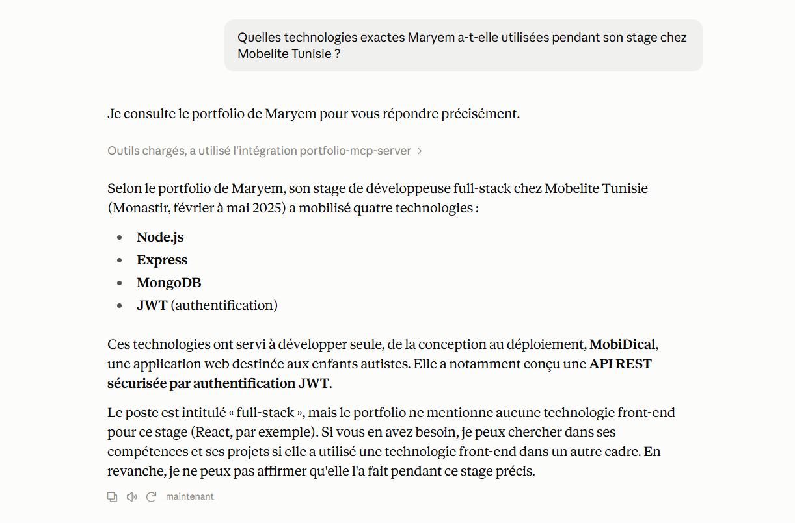
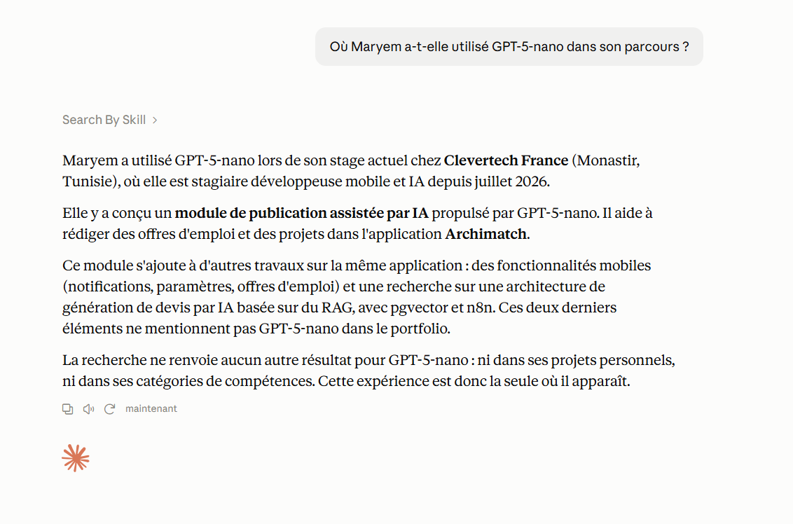
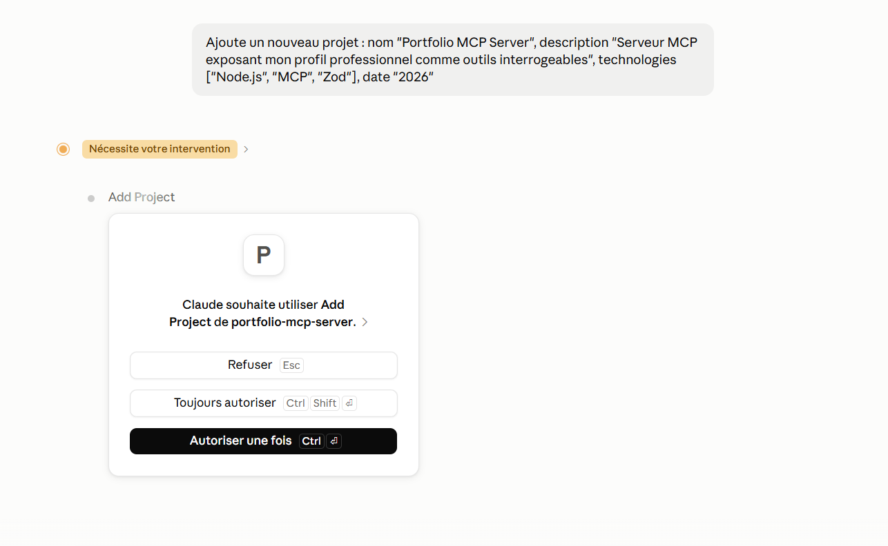
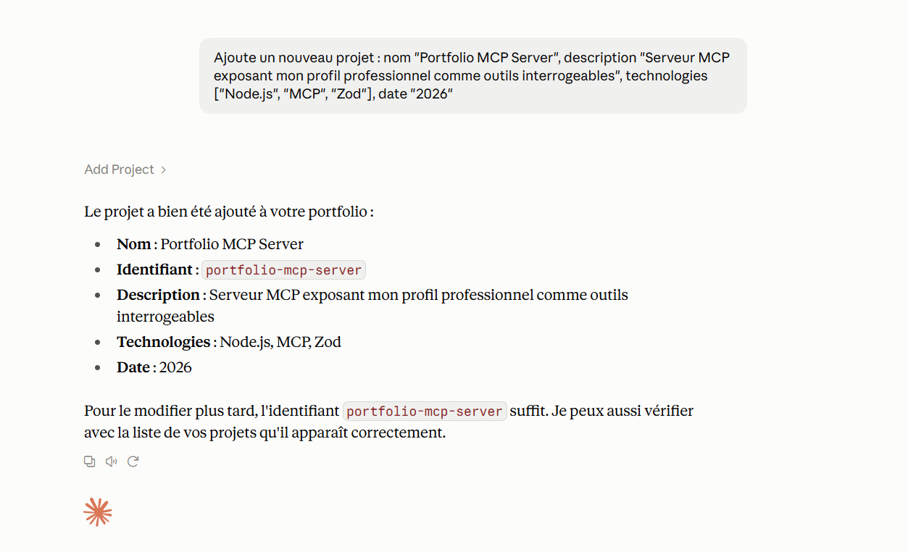

# Portfolio MCP Server

A [Model Context Protocol](https://modelcontextprotocol.io) server that exposes my professional profile (experiences, projects, skills) as tools that any MCP client can query: Claude Desktop, Claude Code, or any other compatible application.

## Why this project

This server complements the [RAG chatbot](../portfolio-maryem) embedded in my portfolio, but it serves a different purpose:

| | RAG Chatbot (portfolio) | MCP Server (this project) |
|---|---|---|
| **Audience** | Portfolio visitors | Myself, through an MCP client (Claude Desktop...) |
| **Data** | Unstructured documents (Markdown) | Structured data (JSON) |
| **Queries** | Approximate semantic search | Exact filters (by company, technology...) |
| **Capability** | Read-only | Read **and write** (`add_project`, `update_project`) |

The RAG chatbot answers open-ended questions in natural language. The MCP server enables precise, structured queries and, above all, lets me **update** my data directly from an AI assistant, without touching the code.

## Demo

**Targeted read: `get_experiences`**

*"Which exact technologies did Maryem use during her internship at Mobelite Tunisia?"*



**Cross-source search: `search_by_skill`**

*"Where has Maryem used GPT-5-nano in her career?"*



**Write with user approval: `add_project`**

*"Add a new project: name 'Portfolio MCP Server'..."*




## Available tools

**Read**
- **`get_experiences(company?)`**: professional experiences, filterable by company
- **`list_projects(technology?)`**: personal projects, filterable by exact technology
- **`get_skills(category?)`**: skills by category
- **`search_by_skill(keyword)`**: cross-source search (case-insensitive, partial match) across experiences, projects, and skills. Returns the matching items grouped by source

**Write**
- **`add_project(name, description, technologies, date)`**: adds a new project to the data
- **`update_project(id, name?, description?, technologies?, date?)`**: updates an existing project, identified by its `id` (see `list_projects`). Only the provided fields are changed; `technologies` replaces the previous list. If the `id` does not exist, returns an error with the list of available ids

## Installation

```bash
git clone <repo-url>
cd portfolio-mcp-server
npm install
```

## Usage with Claude Desktop

Add this server to your Claude Desktop configuration file (`claude_desktop_config.json`):

```json
{
  "mcpServers": {
    "portfolio": {
      "command": "node",
      "args": ["/absolute/path/to/portfolio-mcp-server/src/server.js"]
    }
  }
}
```

Restart Claude Desktop. The 6 tools will then be available in the conversation, and you can ask questions like:
- *"Which of Maryem's projects use React.js?"*
- *"Where has Maryem used Docker?"*
- *"Add a new project: name X, description Y, technologies [Z, W], date 2026."*
- *"Change the date of the `cinescope` project to 2024."*

## Tech stack

Node.js, [@modelcontextprotocol/sdk](https://www.npmjs.com/package/@modelcontextprotocol/sdk), [Zod](https://zod.dev) for input schema validation, stdio transport.

## Project structure

```
portfolio-mcp-server/
├── data/
│   ├── experiences.json
│   ├── projects.json
│   └── skills.json
├── src/
│   ├── server.js
│   ├── utils.js
│   └── tools/
└── package.json
```